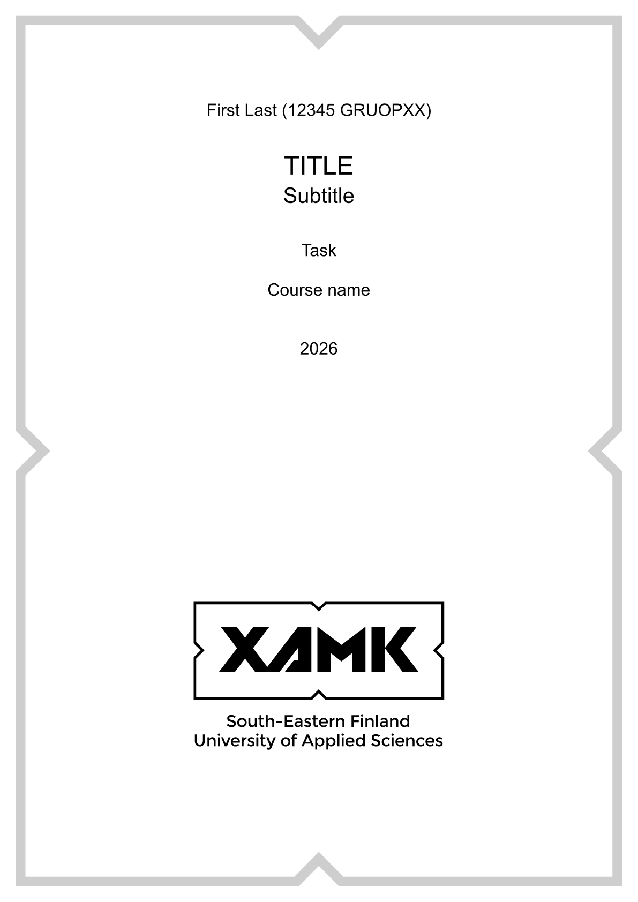
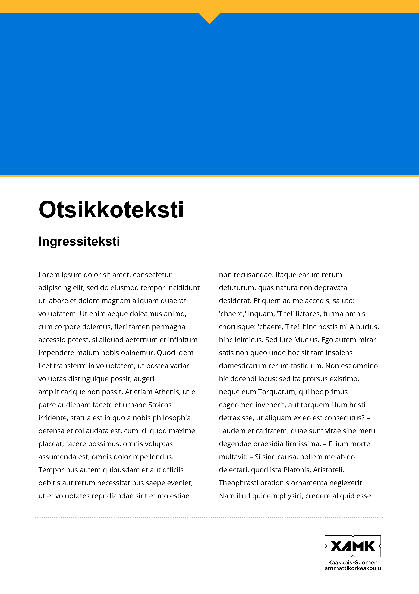
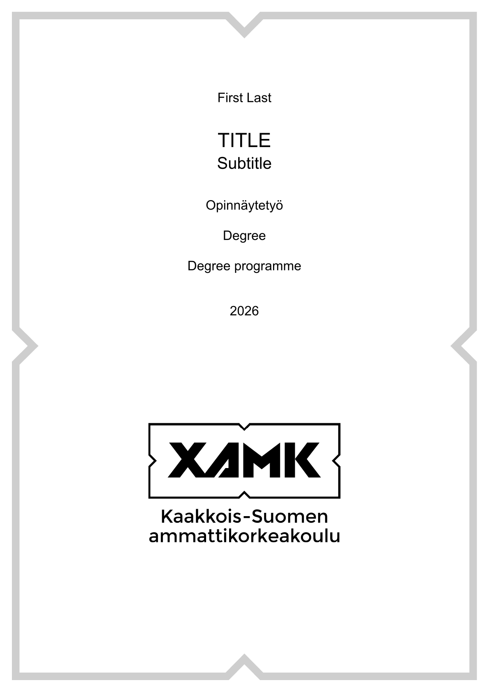

# unofficial-xamk

Unofficial Xamk templates for Typst

Available templates:

<table>
  <thead>
    <tr>
      <th>Template</th>
      <th>Preview</th>
    </tr>
  </thead>
  <tbody>
    <tr>
      <td>long-task (Report or assignment / Pitkän tehtävän malli)</td>
      <td>
        <picture>
          <source height="300px" media="(prefers-color-scheme: dark)" srcset="./thumbnail/thumbnail-long-task-dark.png">
          
        </picture>
      </td>
    </tr>
    <tr>
      <td>scientific-poster (Scientific poster / Tieteellinen posteri)</td>
      <td>
        <picture>
          
        </picture>
      </td>
    </tr>
    <tr>
      <td>thesis (Thesis / Opinnäytetyö)</td>
      <td>
        <picture>
          <source height="300px" media="(prefers-color-scheme: dark)" srcset="./thumbnail/thumbnail-thesis-dark.png">
          
        </picture>
      </td>
    </tr>
  </tbody>
</table>


## Usage

See [package reference (PDF)](./docs/manual.pdf?raw=true)

## Example

```typst
#import "@preview/unofficial-xamk:0.0.0" as xamk

#show: xamk.long-task.with(
  lang: "en",
  metadata: (
    authors: (
      (name: "First Last", group: "GROUPXX", student-number: "12345"),
    ),
    title: [Title],
    subtitle: [Subtitle if needed],
    task: [Task],
    course: [Course name],
    date: datetime.today(),
  ),
  theme: (dark: false, logo-yellow: false),
)

= Introduction

#lorem(100)
```

## Installing

To install as local package you can use:

```bash
just install
```

# Xamk Brand Guidelines

English: https://www.xamk.fi/en/xamk-brand-guidelines/  
Finnish: https://www.xamk.fi/xamkin-brandiohjeisto/  
